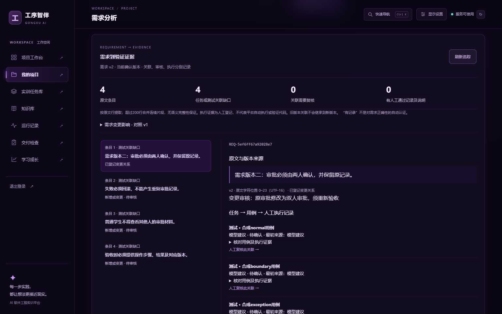
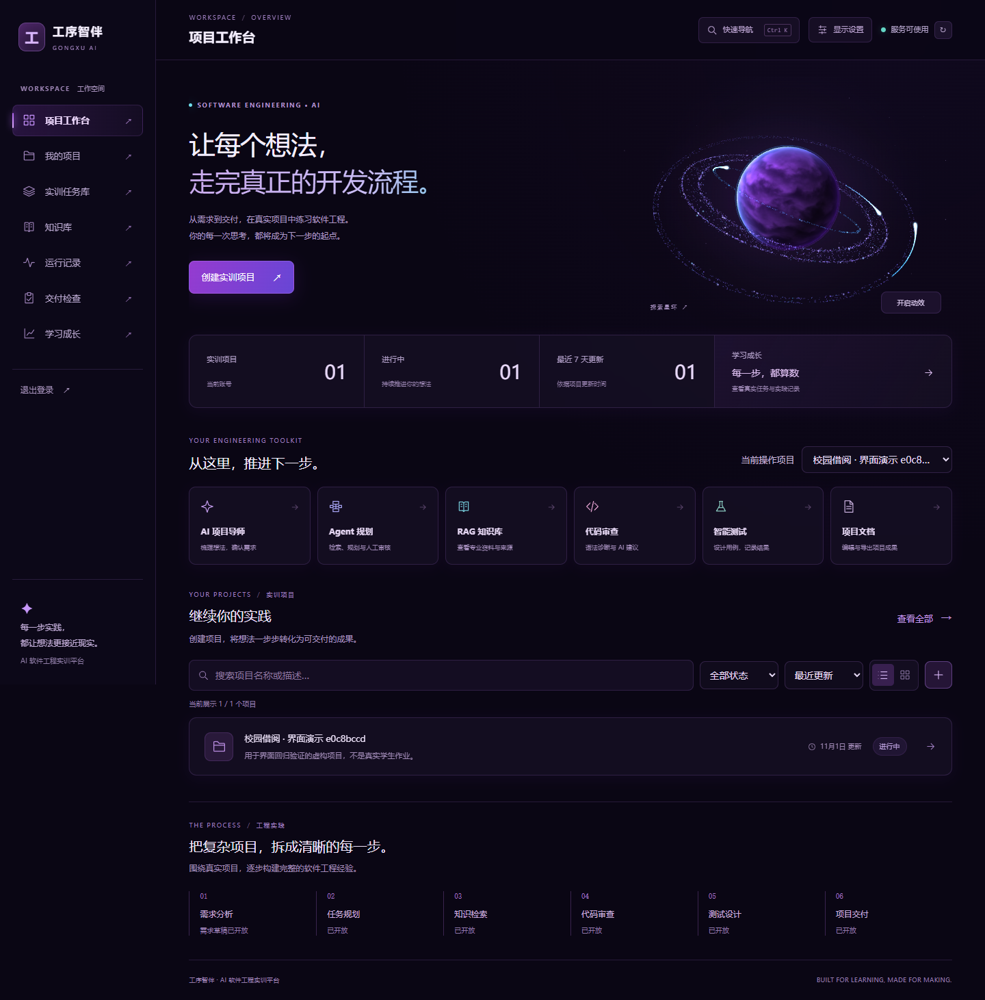

# 工序智伴

## v5 当前能力与验证范围

本轮在v4真实评测之后的当前仓库继续，保护旧包与真实数据。现在Agent页可对长需求审核拆分、逐段生成实际候选任务、持久化暂停/恢复、全局合并审核并事务采纳。需求原文、范围、哈希、方案修订、每次请求与原始输出保留；不确定调用不自动重试，旧版本不能覆盖新计划，采纳不自动建立“通过”证据。详细边界见[长需求规划](docs/LONG-REQUIREMENTS-V5.md)。

只接通规划路径。单次20000字符与存储50000字符边界保持，测试、文档及代码审查的超长上下文尚未接入分段。新链路已经离线、隔离数据库及桌面浏览器验证，模型使用协议替身。**本轮新增收费调用0次，按用户决定长需求真实模型质量待验证；v4已有12次真实响应保留，独立人工审核尚未完成。**[离线审核包说明](docs/AI-REVIEW-PACK-V5.md)区分这两批状态。

沿用下方统一验证入口；新增数据库层`long-plan`检查和`node scripts/long-plan-local.mjs --browser`真实浏览器到隔离数据库验证。022是增量迁移，不清空原数据。实际分层结果、文件清单和剩余事项见[v5交付报告](docs/FINAL-REVIEW-V5.md)、[验证索引](docs/verification/review-v5.json)及[恢复记录](docs/CONTINUATION-V5.md)。独立安装使用锁文件、新依赖目录和新存储，安装脚本未执行；不能当作整台新机器全部环境验收。

技术PDF、[约7分钟中文逐字稿](docs/DEMO-SCRIPT-V5.md)与[一页操作提纲](docs/DEMO-OPERATIONS-V5.md)同步当前能力。本轮没有制作视频，用户自行录制；旧v4视频不代表新增长需求实录。比赛验收仍按[七张截图矩阵](docs/CONTEST-ACCEPTANCE-2026-11.md)，缺失权重/国赛规则、团队信息及未提交状态如实保留。

## v4 历史成果与沿用验证入口

本轮从稳定v3提交`d377765`继续，保留旧交付包与真实数据。新增独立测试执行修订，旧窗口提交返回409并保留输入供比较；任务书与普通项目创建共用草稿、提交快照和请求归属保护；快捷导航从深链接独立读取当前账号目录。需求追踪根据真实关联和执行记录显示下一步，配对审核按需展开，折叠不丢输入。

长需求新增原文分段审阅：位置、哈希、稳定条目标识和跨段依赖可核对，人工审核持久保存，迁移020—021增量应用。**超过20000字符的自动生成仍明确阻止**；分段处理/遗漏检查协议已经替身验证，但生产分段模型生成和全局语义合并尚未启用。详见[分段能力与恢复边界](docs/LONG-REQUIREMENTS-V4.md)。

统一入口（需先安装锁文件中的开发依赖；离线模式不读取真实配置、不调用数据库或模型）：

```powershell
pnpm verify                         # 默认：类型、构建、API/向量单元、全部根JS测试、Python打包、离线评测准备
pnpm verify --list                  # 只列出检查项目
pnpm verify --suite=browser         # 明确选择：受控浏览器、冻结生产资源恢复与首屏测量
pnpm verify --suite=accessibility   # 明确选择：桌面axe自动检查，仍需人工复核
pnpm verify --suite=database        # 明确选择：现有本地数据库/向量，创建合成记录并保留，不调用聊天模型
```

Python3及`pypdf`用于打包回归；找不到时可加`--python=<已安装Python绝对路径>`，不自动下载安装。浏览器层需本地Web服务及已安装浏览器；数据库层需先应用迁移，缺少运行条件必须记录未执行。每次统一验证在`.runtime/verification-v4-<id>/report.json`保存分层命令、结果和日志，不能把不同层次数加成全系统通过率。

[v4进度与恢复](docs/CONTINUATION-V4.md)记录本轮实际通过、失败与修复；[真实AI评测准备](docs/EVALUATION-V4.md)记录固定合成输入及费用审批范围。真实模型评测独立于`verify`，没有明确批准不会发起收费调用。公开案例核验和原创实现见[参考说明](docs/REFERENCE-REVIEW-V4.md)。本轮材料、实际修改、分层验证与剩余事项见[v4交付报告](docs/FINAL-REVIEW-V4.md)和[验证索引](docs/verification/review-v4.json)，比赛要求见[截图矩阵](docs/CONTEST-ACCEPTANCE-2026-11.md)。下方v3结果只作历史记录，不能充当v4结果。

v4初次交付离线15步通过，API125、Embedding4、根JS74、Python打包7分别通过；受控Edge96组、Firefox/WebKit本轮相关各10组、真实本地数据库统一17步和实际服务8组通过，不能跨层相加为全系统通过率。技术评审稿29页、答辩稿12页，视频为[十二场景v4工程草稿](docs/demo-v4/README.md)。视频中的聊天仍为替身，未重新拍摄真实模型片段。

2026-11-01经范围批准，完成**12次真实DeepSeek评测调用**，没有重试或追加收费。该批返回内容、费用估算与局限见[真实评测补充报告](docs/AI-EVALUATION-V4-2026-11-01.md)及[脱敏证据](docs/verification/ai-evaluation-v4.json)。这不是12项质量全通过：长需求当前仍拒绝生成，人工盲评与师生试用未执行，不提供效果提升百分比。应用模型配置、业务代码和真实数据未因评测改动。

## v3 既有能力与历史验证（保留供对照）

工序智伴是一款面向高职软件工程实训的 AI 原生 Web 应用，用于「传智杯 AI WEB 网页开发挑战赛」备赛。现有需求、Agent、RAG、审查、测试、文档和成长功能保留，本轮重点修复跨项目编辑、长文本截断、向量并发和版本证据问题，并实现“需求条目→任务→测试→人工执行证据”的追踪闭环。

截至2026-11-01本轮验证，使用了真实本地PostgreSQL/pgvector、本地中文向量和桌面浏览器，也使用了明确标识的模型/HTTP替身。**本轮没有发起收费模型调用**，新提示词的真实模型效果、线上部署、长期负载与教学成效仍待验证；此前真实DeepSeek报告只作为历史记录。进展、未运行项和恢复方法见[本轮阶段记录](docs/CONTINUATION-2026-11-01.md)；[上一版交付报告](docs/FINAL-REVIEW-2026-11.md)保留为v2历史，不能当作v3当前测试结果。快速恢复见[启动与验收](docs/STARTUP-AND-VERIFICATION.md)。

本轮结果集中在[v3评审报告](docs/FINAL-REVIEW-V3-2026-11-01.md)和[分层验证索引](docs/verification/review-v3.json)，包括问题对应修复、实际命令、源码变更列表、报告校验值及未执行原因。空数据库001—019迁移、重复迁移和不依赖AI的需求/草稿持久化已经实际检查；该独立合成数据库保留，不修改原业务库。外部评审副本的范围与重制方式见[源码包说明](docs/SOURCE-PACKAGE.md)。

新增能力包括：完整原文条目标识和位置、模型建议/人工确认关联分离、用例修订与历史证据、需求变更影响、人工审核入口、可取消的向量检索/索引等待。超过20000字符的生成会明确阻止，完整原文仍可保存，不静默截断；此边界不等于支持任意长度生成。详细规则与安全迁移见[需求追踪及恢复](docs/TRACEABILITY-AND-RECOVERY.md)。

v3继续补齐明确的任务—用例配对、同版本证据变化提示、文档修订冲突与历史、Agent中断/取消/人工采用记录。代码审查草稿可以独立保存；保存并离开只存入本项目，不触发收费审查。知识导入、新建项目也有未保存保护，文件乱序和迟到保存不能清掉新输入。工作区按登录会话隔离；正常退出先处理未保存内容，账号失效或跨标签更换会话时不跨账号恢复内存草稿。迁移010—019均为增量结构，旧数据不清空。

代码审查可明确选择“结合当前确认需求与检索资料”或“仅代码”。前者完整读取提交时的确认需求，按段检索本账号资料，并永久保存本次实际提供给模型的原文快照；后来换版会提示历史来源。没有配置、没有匹配和旧记录来源未知分别标注，检索失败不会伪装成有依据的成功。来源快照用于人工核对，不代表模型确实引用或资料支持全部建议。超过20000字符的项目需求明确阻止完整审查；只有主动选择“仅代码”才跳过需求。取消只停止后续等待，不保证撤销已经发出的模型计费或数据库提交。

成长中心默认按各项目最近已确认需求统计任务与用例，旧版本的完成或通过不计入当前进度。历史累计需要主动选择，且不据此生成当前下一步建议；审查、语法诊断和最近活动明确为账号历史。用例数量与当前人工结果不是累计执行次数，也不是能力评分。范围切换会取消旧读取，失败或返回范围不一致不会继续展示旧数字。

任务状态写入同样在服务端核对当前确认需求，与需求确认共用项目锁顺序；其他标签确认新版本后，旧任务写入返回409且不新增状态事件。旧页面会暂停编辑，并提供经过未保存保护的重新读取入口，不能仅靠前端“历史只读”限制。

草稿更新和需求确认还必须携带实际阅读过的`expectedContent`原文。内容已变或确认目标不再最新时明确拒绝，缺少核对信息的旧请求也不能覆盖；界面保留原文和继续输入的草稿，重新读取前仍可保存、放弃或取消。并发初始化需求追踪可重复读取，不覆盖已有人工审核或把读取计为新的验证证据；真实本地并发测试见启动说明。

文档生成保留任务/用例标识、修订、完整步骤与人工执行说明，不再截掉说明末尾的限制。任务与测试各最多50条，完整结构化资料最多30000字符；超过数量或资料预算时在模型调用前明确阻止，已有记录和文档保留。当前不支持将超限资料自动分批合成为完整报告，不能通过删除证据来规避边界。

测试中心按需求版本完整计数、每页50条，项目概览和交付读取同一完整统计，不用当前页推算全部通过。文档目录每页20份，概览/交付读取当前确认版本各类型最新摘要；知识目录每页20份，较早资料可定位和手动重建索引。列表发生影响翻页的变化会要求刷新，草稿不因翻页失败清空。索引“就绪”还会核对当前向量模型和分块完整性，旧模型向量不会假报为当前可检索。PDF文件字节、文本字符与分块限制分别说明，超过限制在保存前明确拒绝。

普通只读请求的完整响应有15秒等待边界；非法JSON或项目数据形状显示可恢复错误。工作区模块下载失败保留导航和相邻编辑器，用户主动重新加载前仍须处理未保存编辑。运行回看在当前读取完成后才进入下个自动刷新周期。Markdown排版按需加载，等待或资源下载失败时保留完整原文、继续编辑和复制，支持重试排版；文档大纲在实际排版完成后更新。P1阶段受控生产浏览器中，首页JS由458,518字节降至292,487字节；这是资源量变化，不宣称等比例用户速度提升。条件、样本与失败恢复证据见[首屏性能验证](docs/PERFORMANCE-V3.md)。



RAG区分零命中、有引用回答，以及“已召回候选但资料不足（模型判断）”。最后一种允许模型明确不回答，候选原文单独展示且不标作答案引用；正常回答仍必须引用真实返回的片段，未知或矛盾引用仍拒绝。分支经过协议和真实本地检索联调，实际模型能否正确判断不足尚待评测。

版本化评测入口为 `pnpm eval:offline`；`pnpm eval:prepare`准备实际路由的合成输入，`pnpm eval:report`离线核对明确提供的记录。输入、模型、资料或设置不一致及缺少人工判断时拒绝计算可比结果，真实模型三流程对比仍待授权；[案例与盲评协议](evaluation/README.md)没有虚构成绩或提升百分比。[竞赛截图逐项检查](docs/CONTEST-ACCEPTANCE-2026-11.md)只采用七张图清晰可见的要求，评分权重、国赛细则及裁切部分为信息不足。

团队信息：参赛者拟报C组，需自行核验每位队员学籍及报名。学生姓名/学校/分工与指导教师尚待真实填写；截图要求1—3名同校学生、教师不超过2名。不得用演示账号作为团队信息。

另有`pnpm eval:retrieval-local`真实本地检索入口：冻结15篇原创合成资料与16个问题，首次12个普通问题中top-1/top-3均命中11个，保留1个凭据/日志问题的遗漏。随后先冻结追加问题及指令对照方案，再执行30题×2方案；指令没有改善可回答问题召回，部分无答案问题反而多返回片段，因此生产默认保持不变。冲突和无答案场景单独记录，不把多返回片段当作正确答案。该结果不是模型回答正确率、教师评价或算法提升比例，详见[检索对照记录](docs/RETRIEVAL-STUDY-V3.md)。

本轮材料包括29页[技术说明与生成入口](docs/TECHNICAL-MATERIAL.md)、12页[可编辑答辩草稿及讲稿](docs/DEFENSE-DECK-V3.md)、[工程演示草稿](docs/demo-v3/README.md)。全部为待参赛者复核的本地材料，真实模型质量、团队信息、仓库评审访问及正式提交仍待完成。

## 技术架构

- 前端：React、TypeScript、Vite、Tailwind CSS。
- 后端：Node.js、TypeScript、Fastify。
- 数据库：PostgreSQL，知识向量使用 pgvector；迁移文件在 `apps/api/migrations/`。
- AI 服务通过后端接入，聊天与向量模型独立配置。密钥不放入前端或版本库。

## 工作台界面

当前界面统一采用深空紫黑主题，提供项目工具入口、项目搜索与筛选、列表/网格切换、项目内导航、Markdown 编辑预览与文档大纲、代码编辑辅助以及测试用例筛选。Agent 页面展示实际阶段、工具记录、任务依赖图和可操作任务看板；知识资料支持拖放选择，检索片段可展开并复制。项目概况和成长数据来自当前账号的真实记录，读取失败时不会显示成零条数据。具体实现和竞赛要求核对见 [界面升级记录](docs/UI-REVIEW.md)。

右上角“快速导航”支持 `Ctrl/Cmd + K` 打开，搜索页面、项目和当前项目的工具；方向键选择，Enter 打开，Esc 关闭。“显示设置”可调整信息密度、内容字号和侧栏宽度，偏好只保存在当前浏览器。代码输入区用 Tab 缩进，先按 Esc 再按 Tab 可移出编辑器；星环可手动暂停，并遵循系统减少动态效果设置。

项目概览的“项目推进概览”汇总已确认需求、当前版本任务、人工测试记录与六类文档，显示待处理事项并提供下一步入口，可刷新或复制实践快照。它只读取接口，不自动调用模型或改变状态；任务、测试与文档统一按最近已确认需求过滤，历史任务不计为当前版本完成。测试使用完整版本计数，文档使用当前各类型最新摘要；读取失败、来源不符或旧接口没有完整统计时显示“暂不可用”，不从部分列表宣称齐备。交付旧核对在依据变化后保留备注并要求主动重核，不自动继承“已通过”。

需求页的“版本记录”支持历史正文预览、历史版本之间或与当前编辑区逐行对比、“只看变化”和复制。使用旧版本编辑前需确认替换当前未保存内容，之后仍需手动保存才会创建新版本。大段差异采用有上限的比较与分批展示，保留旧记录。两个新增视图按页面加载，不在首页提前下载。操作与验收结果见 [项目推进与需求版本记录](docs/PROJECT-CONTROLS.md)。

以下为独立演示账号的实际浏览器截图，数据来自操作验证，不代表真实学生成绩：

工作台另外提供三个独立入口：`/missions` 实训任务库（六份原创任务书、筛选、收藏并创建项目）、`/runs` Agent 运行记录（实际步骤、耗时、工具证据与 JSON 导出）、`/delivery` 交付检查（按项目和需求版本记录人工核对、备注与 Markdown 导出）。创建项目使用原有数据库接口；收藏和人工清单仅保存在本机，页面明确提示，不会自动确认计划或执行测试。参考案例、功能边界和最新验证见 [新增工作台页面说明](docs/WORKBENCH-EXPANSION.md)。



工作台的三维星环是独立的装饰场景，在工作台默认静态、主动开启后播放，支持暂停、拖动和减少动态效果，不参与模型调用。独立预览位于 `/previews/planet-orbit.html`，旧版 CSS/SVG 留在 `/previews/archive/planet-orbit-css-v2.html`。当前三维版通过本地 HTTP 服务加载模块，需要 WebGL2；所有运行资源本地提供，不依赖 CDN。轨道代码适配自 MIT 许可的 [SaturnWebGL](https://github.com/adelmassimo/SaturnWebGL)，使用 Three.js 0.187.0，来源和版权声明见 `apps/web/public/previews/vendor/NOTICE.txt`，前端依赖许可见 `apps/web/public/THIRD-PARTY-LICENSES.txt`。

## 环境准备

需要 Node.js 22 或更高版本、pnpm，以及启用了 pgvector 的 PostgreSQL。可使用 Docker Compose 启动仓库内的本地开发数据库；如果使用外部数据库，需提前创建数据库并确认有安装 `pgcrypto`、`vector` 扩展的权限。Compose 中的默认账号密码仅供本地开发。

```sh
pnpm install
docker compose up -d
```

复制 `apps/api/.env.example` 为 `apps/api/.env`，按实际环境配置数据库连接。不要提交 `.env` 或真实密钥。如果 PostgreSQL 已在其他地方运行，可以不使用 Docker，直接配置实际 `DATABASE_URL`。

```sh
pnpm --filter @gongxu/api db:migrate
pnpm dev
```

前端默认访问 `http://localhost:5173`；后端默认监听 `http://127.0.0.1:3001`。前端开发代理会将 `/api` 请求转发到后端。`GET /health` 只说明后端进程可响应；`GET /ready` 会实际检查数据库连接、当前版本所需迁移和 pgvector 扩展，任一条件未满足时返回 503。登录页与工作台据此显示真实可用状态。

Windows 下可使用 `pnpm start:local` 启动本地开发服务并检查状态。脚本优先识别当前工作区已经安装的本地 PostgreSQL 启动器，其他工作区默认使用仓库的 Docker Compose；已有外部 PostgreSQL 可运行 `pnpm start:local -Database external`。首次构建可加 `-Build`，修改 API 源码或本地环境配置后可加 `-RestartApi`。脚本不会输出配置内容或发起收费模型请求；日志及进程记录保存在被 Git 忽略的 `.runtime/services/`。它使用默认端口 3001、3010、5173，不是公网部署脚本。

电脑重启会停止这些本地进程。Windows 可运行 `powershell -NoProfile -ExecutionPolicy Bypass -File scripts/install-windows-startup.ps1`，为当前用户创建桌面的“打开工序智伴”和登录启动入口。以后登录 Windows 时会在后台启动本地服务；双击桌面入口会先检查服务，再打开工作台。重复点击会复用已运行的服务，并通过启动锁避免重复启动；不自动调用收费模型。启动状态记录在 `.runtime/services/launcher.log`，只写固定状态，不记录密钥或子进程正文。

需要移除本项目创建的两个快捷方式时，可运行同一安装脚本并加 `-Remove`；它只移除指向本工作区启动器的快捷方式，不删除项目或数据库。启动脚本在系统未配置 Node/pnpm 路径时会尝试已有的本机运行环境；本机地址仍为 `http://127.0.0.1:5173/dashboard`，电脑关机时不能访问。

本机的 Docker 安装仍受 Windows 组件损坏影响，因此本轮验证使用原生 PostgreSQL 16.15 + pgvector 0.8.7，数据库数据位于工作区外层 `.setup/postgresql/data16/`；Docker 配置继续保留。切换数据库部署方式时应迁移真实数据，并避免两个数据库同时占用 5432 端口。

### AI 与知识检索配置

在仅供服务端读取的 `apps/api/.env` 中配置 `AI_BASE_URL`、`AI_API_KEY`、`AI_MODEL`，以启用兼容 Chat Completions 的真实模型。DeepSeek可使用其官方API地址，`AI_MODEL`填写自己账号当前可用的模型标识，并将密钥填入 `AI_API_KEY`；本轮没有重新验证提供方模型列表或账号权限。参见 [DeepSeek 官方 API 文档](https://api-docs.deepseek.com/api/create-chat-completion/)。不要将密钥写入前端或提交到 Git。系统显示“已配置”仅代表配置项齐全，不代表服务已经联通。

配置后可执行 `pnpm --filter @gongxu/api ai:check`，单独发起一次真实模型请求；此检查会产生一次 API 调用，可能计费，不要求数据库或 Embedding 已启动。未配置时不会伪造成功。

模型请求支持 `AI_TIMEOUT_MS`（1–120 秒，模板为 90 秒）、`AI_MAX_OUTPUT_TOKENS`（256–16384，默认 4096）及可选的 `AI_REASONING_EFFORT`。推理选项的可用值与行为取决于提供方和具体模型；服务不支持该参数时留空，后端会省略它，不把某个模型的默认行为套用于所有模型。规划结果仍经过结构、依赖和来源校验。模型报告输出被长度限制截断时，后端返回 `ai_output_truncated`，不会把残缺内容保存为完整草稿。参数行为需对照提供方文档及获授权的实际调用。

连接失败时请根据实际错误处理。`.env.example` 是可提交的配置模板，真实密钥只填写到被 Git 忽略的 `apps/api/.env`；修改配置后须重启后端。不要在聊天、截图或 Git 评论中发送密钥。

| 错误或现象 | 处理方式 |
| --- | --- |
| `ai_auth_error` | 模型服务拒绝认证或访问，请检查本地 `AI_API_KEY` 是否有效及服务账号的访问权限；这不会使应用内登录失效。 |
| `ai_insufficient_balance` | 检查模型服务账号的可用余额。 |
| `ai_rate_limited` | 稍后重试，并检查模型服务的并发和请求频率限制。 |
| 数据库连接被拒绝 | 检查 Docker Desktop 是否已启动，再运行 `docker compose up -d`；外部数据库需核对本地 `DATABASE_URL` 对应的服务和端口。 |

模型服务错误只返回分类后的错误码，不向浏览器转发上游原始错误正文、密钥或服务地址。

Embedding 与聊天模型独立：配置 `EMBEDDING_BASE_URL`、`EMBEDDING_MODEL` 及按需 `EMBEDDING_API_KEY`，使用兼容 `/embeddings` 的服务。指向本机回环地址时可以不提供密钥；外部服务要求配置密钥。配置为 DeepSeek 聊天地址时会被拒绝；向量配置错误会禁用检索并在服务端提示，不会阻止其他 API 启动。尚未选择或配置向量服务时，仍可保存和分块文本资料。

仓库提供可选的 [本地中文向量服务](apps/embedding/README.md)，使用固定版本的 BGE-small-zh-v1.5 ONNX 量化模型，在 CPU 上生成 512 维向量，无需 Docker 或额外 API 密钥。服务单独下载模型、启动和验证：

```sh
pnpm --filter @gongxu/embedding model:download
pnpm --filter @gongxu/embedding build
pnpm --filter @gongxu/embedding start
```

首次下载模型后，在另一个终端执行 `pnpm --filter @gongxu/embedding check` 检查真实向量生成和中文样例的相似度排序。模型文件有固定哈希校验，默认仅监听本机端口 3010。具体配置和网络镜像选项见该服务 README。

知识库支持文本、Markdown 和可提取文本的 PDF 的解析、分块及保存；PDF 上限 3 MB、80 页、20 万字符，扫描件不包含可提取文本时会明确报错，暂不支持 OCR。配置 Embedding 服务后可建立向量索引、按账号检索并返回片段来源。PDF 依赖 [PDF.js](https://github.com/mozilla/pdf.js)，字体及 CMap 从安装的本地依赖读取；公开部署前应进一步对 PDF 解析进程进行资源隔离。更换向量模型或预处理方式时必须重新建立向量索引。Agent 基于已确认需求调用模型，Embedding 已配置时会实际检索知识；未配置时知识检索明确显示“已跳过”，计划标识缺少知识依据。页面在运行期间持续读取真实步骤与工具记录，计划需用户确认后才创建任务。服务未就绪时会显示真实状态，不提供模拟成功结果。

代码审查目前的确定性检测仅覆盖 JavaScript/TypeScript 语法，不执行提交的代码；AI 的安全、性能等意见属于待验证建议。生成的测试用例默认未执行，人工修改用例后执行状态会重置。文档草稿读取已确认需求、相关任务和人工测试记录，缺失的 API、代码和部署事实须人工补充。

注意：当前登录限频为单进程机制，前端令牌存储在本地浏览器中；上线前需增加 HTTPS、共享限流、会话保护及安全审查。Agent通过心跳、总截止与读取时检查识别中断，保留已完成记录，允许人主动取消或新建运行；不会自动恢复或重放收费调用。

当前后端开发命令先编译 TypeScript，再监听编译后的文件；修改后端源码时需重新运行构建或重启开发命令。前端支持 Vite 热更新。

## 构建与测试

```sh
pnpm build
pnpm typecheck
pnpm test
pnpm test:ui-models
pnpm test:workbench
pnpm test:review-package
pnpm verify:reliability-ui
pnpm verify:web-entry
pnpm eval:offline
```

上述命令检查现有工程，不代表尚未实现的业务功能已通过测试。

`pnpm test` 会先检查可提交的环境变量模板，要求 API 密钥、令牌和 secret 字段为空；此检查不会读取本地 `.env`，也不打印违规字段值。真实聊天检查只输出状态与耗时，不输出模型原文或配置内容。真实模型、数据库和业务联调需另外运行并记录结果。

启动真实本地服务后，可选择以下联调命令。脚本会创建明确标记的测试账号、项目和资料，保留测试记录，不删除原有数据；随机测试凭证只在测试进程中使用，结束后注销会话。报告保存在被 Git 忽略的 `.runtime/`，不会保存 API 密钥或登录令牌。

```sh
pnpm smoke                      # 真实数据库、解析、持久化及权限；不调用云模型
pnpm smoke --with-rag           # 额外验证真实向量索引与来源检索
pnpm smoke --with-ai            # 额外调用真实云模型，验证完整流程，会产生 API 用量
pnpm smoke:browser             # 浏览器操作、页面路由及移动布局；需要本地向量服务
pnpm smoke:browser --with-ai    # 额外验证 Agent 运行过程与审核按钮，会产生 API 用量
pnpm smoke:ui                  # 新界面回归：导航、显示偏好、编辑、检索、响应式；需要向量服务
pnpm smoke:ui --with-ai        # 增加真实 Agent、审查、RAG、测试用例及文档交互，会产生 API 用量
pnpm smoke:visual              # 星环真实画面、方向、倍速、暂停、拖动、减少动画和图形恢复；不调用模型
pnpm smoke:visual --webkit     # 同样的 9 组检查，使用 Playwright WebKit
pnpm test:ui-models            # 18 项纯前端规则检查：版本隔离、真实状态、边界与逐行比较
pnpm smoke:project-controls    # 8 组项目概览/版本对比检查，使用真实本地数据库，不调用模型
pnpm smoke:project-controls --webkit # 同样检查，使用 Playwright WebKit
pnpm test:workbench            # 10 项规则检查：任务书、时间显示、人工清单存储与版本隔离
pnpm smoke:workbench           # 11 组新页面检查；真实数据库，不调用云模型
pnpm smoke:workbench --with-ai # 12 组，增加一次真实规划与运行证据比对，会产生 API 用量
pnpm smoke:workbench --with-ai --webkit # 同样检查，使用 Playwright WebKit
```

浏览器检查在 Windows 默认使用已安装的 Edge；其他系统可先运行 `pnpm exec playwright install chromium`，或通过 `SMOKE_BROWSER_CHANNEL` 选择已安装的兼容浏览器。接口测试地址使用 `SMOKE_API_URL`，浏览器地址使用 `SMOKE_WEB_URL`；这些脚本只允许无凭证的本机回环地址，避免误写线上业务数据。`smoke:ui` 默认包含 8 组检查，`--with-ai` 包含 11 组；它保留原有两套联调脚本及断言，单独记录新交互。其人工测试状态样例明确记录为“阻塞”，不声称执行了示例项目代码。常规自动化测试中的数据库和模型替身不等同于这些真实联调结果。

`smoke:visual` 只需前端服务和可用的 WebGL2 环境，不要求登录或调用 API。它比较实际截图像素并观察 GPU 时间与绘制次数，避免“存在动画样式但画面没有旋转”的假阳性。WebKit 可先通过 `pnpm exec playwright install webkit` 安装；Windows 上的自动化 WebKit 结果不是 Safari 真机结论。各脚本保留本轮报告与截图，不覆盖旧报告。

`smoke:project-controls` 使用隔离演示账号，实际保存、确认与恢复需求版本；额外的读取失败和跨版本统计场景通过明确标识的浏览器受控响应检查，不冒充模型调用。测试结束后注销账号，报告不保存凭证。`test:ui-models` 使用 Node 的 TypeScript 类型剥离能力，本机已在 Node 24.22.1 验证。

`smoke:workbench` 同样使用隔离演示账号，验证任务筛选收藏、真实项目创建、人工清单保存与导出、跨项目及需求版本隔离、运行证据、自动刷新和响应式导航。存储拒绝、接口读取失败、长文本及脚本字符串属于明确标识的受控边界检查；开启 `--with-ai` 后另行验证真实 DeepSeek 记录。`test:workbench` 也使用 Node 的 TypeScript 类型剥离能力。

本工作区的 WebKit 已下载在 `.runtime/browsers/`；复用这一缓存时，在仓库根目录的 PowerShell 中先运行 `$env:PLAYWRIGHT_BROWSERS_PATH="$PWD/.runtime/browsers"`，再执行 `pnpm smoke:visual --webkit`。新环境可使用 Playwright 的默认安装目录，无需设置该变量。

## 竞赛与团队信息

赛项要求和待确认项目见 [竞赛核对清单](docs/competition-checklist.md)，连续演示的操作与讲解准备稿见 [6 分 40 秒演示路线](docs/DEMO-WALKTHROUGH.md)。准备稿不代表已交付正式视频。参赛团队、学校及指导教师信息由实际参赛人员确认后填写，不预填或虚构。

本轮桌面截图、交互验证与交付缺口另有 [6 页离线 UI 验收报告](output/pdf/工序智伴-桌面UI验收报告.pdf)。它用于界面验收，不代替正式参赛技术文档。
