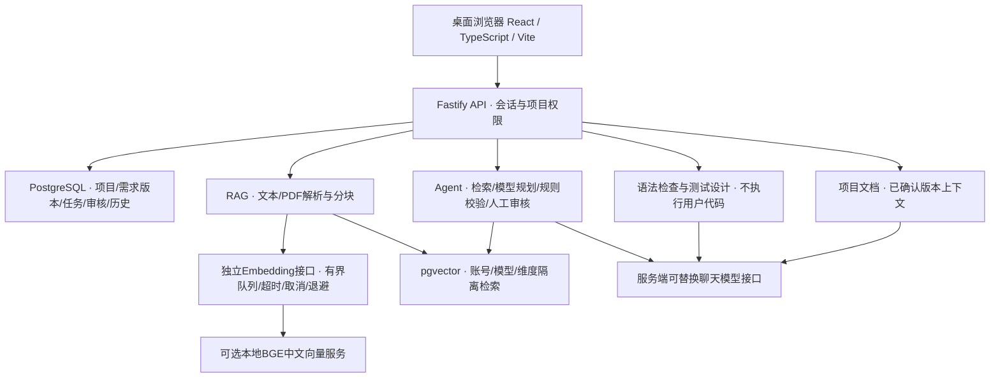

# 工序智伴技术文档素材（本轮可复核版）

比赛名称：传智杯 AI WEB 网页开发挑战赛。定位是面向高职软件技术学生的AI原生软件工程实训工作台。正文素材供后续排成不超过30页PDF；本文件本身不是已提交的正式技术PDF，团队与参赛资格仍由参赛者补齐。

## 真实问题与实现重点

学生从想法走向可交付项目时，容易遗漏需求、脱离验收条件规划、把AI建议当已证实错误、把历史测试通过误用于新版本。平台把需求确认、检索资料、计划审核、代码语法检查、测试设计、人工执行登记和项目文档组织在同一项目及需求版本下。

本轮改进重点为可靠性与证据链，而不是增加页面。前端对项目请求使用取消及代次校验，保存检查编辑归属；需求、文档、测试和追踪审核通过统一保存/放弃/取消流程保护未保存内容。后端把原文完整性、队列容量、用例修订和关联隔离放进可以运行的规则与数据库约束。

## 系统结构

聊天服务和向量服务分别配置；DeepSeek聊天接口不承担向量生成。API密钥只由服务端本地环境加载。PostgreSQL与pgvector复用同一数据库以降低部署成本并使用事务、外键和账号过滤。React按已有模块延迟加载，在保留技术栈和业务逻辑的条件下降低入口包体积；未引入新的前端运行依赖。

## AI Agent与人机协同

Agent实质执行知识检索工具、模型规划、结构/依赖/引用校验；不展示伪造“思考过程”。运行、步骤、工具输入摘要、片段来源与失败状态入库。模型输出不合法时最多修正规划一次，失败如实记录；没有Embedding时显示跳过，不伪造检索。计划进入人工审核后，只有确认才创建任务。并未实现多个独立Agent并行自治，也不是能自动完成任意开发的执行器。

新计划携带需求条目建议，规则补充缺项、验收方法与知识依据不足提示。单任务、零引用不直接判错；人工需核对原文。界面分别显示规则验证、模型关联建议和人工审核，避免JSON合法就被当成工程完整。

## RAG与知识证据

文档上传后可在未配置向量服务时先解析、分块和保存。PDF保留页码，文字保留偏移；扫描件明确不支持OCR。索引和查询由可替换Embedding接口处理，实际本机服务为CPU中文模型方案。向量查询按账号、模型和维度过滤；答案只允许引用实际返回的片段ID，无片段时不调用聊天模型。

存在引用不能证明原文支持结论，界面提供可核对原文与提示。本轮未授权收费模型，故不能报告新的RAG回答质量、冲突资料识别率或提示注入成功抵抗率。离线评测仅验证协议约束，真实语义评测须另执行。

## 需求到证据的应用创新

稳定源条目标识、版本内任务/用例关联、人工审核和执行说明构成可追溯链。用例编辑保留旧结果快照并重置当前状态，旧修订执行登记被拒绝。新需求不继承旧通过；变更视图列出历史任务、用例和文档及旧原文，用户登记变更关系，不自动宣称新需求已验证。这是可查源码与数据库记录的应用创新，不宣称发明底层LLM、向量检索算法或WebGL技术。

## 可靠性、测试与限制

完整命令、范围与结果在 `FINAL-REVIEW-2026-11.md`。统计区分单元/规则替身、受控浏览器、真实本地DB/向量及模型替身浏览器。真实模型、多人长期负载、公网可用性、学生试用与教师盲评未执行。本机不能代表线上稳定性；进程级队列/限流不是分布式队列；Agent进程中断恢复、OCR、语义覆盖裁判和安全自动执行沙箱仍不在本轮实现范围。

## 建议PDF编排（总计24页，尚未排版）

封面与摘要2页，需求与场景3页，产品流程与桌面体验3页，架构和数据设计4页，Agent/RAG/追踪实现5页，测试与评测3页，部署/安全/恢复2页，原创边界/许可/总结2页。团队信息待真实填写；截图只用本轮合成项目，并在图注说明模型替身范围；不可把本素材中的拟定页数当作实际PDF页数。

## 当前演示链（建议7分20秒）

0:00–0:40解释学生问题与项目定位；0:40–1:35演示需求保存、版本确认与未保存编辑保护；1:35–2:25展示全文检索原文、来源和排队/失败恢复；2:25–3:30展示真实Agent步骤与缺项审核；3:30–4:35展示条目到任务/用例的人工关联；4:35–5:30登记人工结果，再修改用例展示旧证据留存、当前状态失效；5:30–6:20确认新需求，展示影响和禁止旧通过继承；6:20–7:00文档及交付检查；7:00–7:20总结能力边界。

正式录制需5—8分钟、MP4、至少1080p、普通话。未授权实时模型时只展示明确标注的历史真实记录或说明录制尚待真实模型验证，不能把本轮替身流程作为真实模型演示。当前没有完成正式参赛成片。
