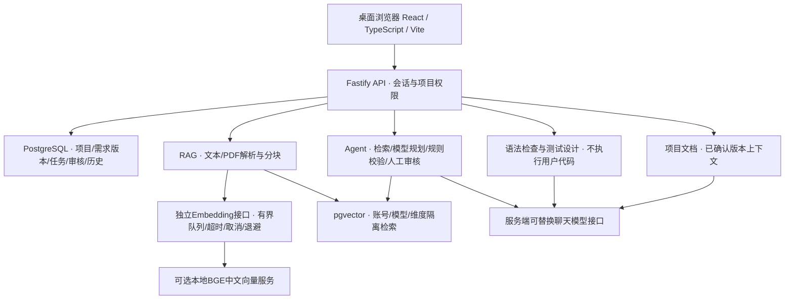

# 工序智伴技术文档素材（本轮可复核版）

比赛名称：传智杯 AI WEB 网页开发挑战赛。定位是面向高职软件技术学生的AI原生软件工程实训工作台。v4技术评审稿为`output/pdf/gongxu-zhiban-technical-v4.pdf`，覆盖技术、实现、测试与限制，实际页数与逐页检查见同目录`technical-pdf-v4-manifest.json`。v3文件保留。材料尚未提交，团队与参赛资格由参赛者真实补齐，不能将工程替身测试写成模型效果。

## v4实现增补

- 测试定义修订与执行修订分开：旧窗口提交返回409，保留输入并明确比较；迁移020和真实数据库并发回归可复核。
- 实训任务书复用普通项目创建的请求归属、提交快照、草稿保护，晚到成功不抢导航。快捷导航首次打开独立读取当前账号项目目录。
- 追踪页面根据真实关联与配对证据给出下一步，高级审核按需展开；不自动确认关联或执行。180ms状态反馈在减少动态效果模式关闭。
- 长需求完整原文分段、偏移、哈希、跨段条目和人工审阅已实现，迁移021保留独立审核历史。顺序处理与合并遗漏检查由受控处理器验证；生产长需求模型生成未启用，20k安全限制保留。详见`LONG-REQUIREMENTS-V4.md`。
- `pnpm verify`覆盖全部根脚本、Python打包、类型/构建/单元与离线评测准备。受控浏览器、真实数据库与收费模型分层，详见`FINAL-REVIEW-V4.md`。

以下既有结构与业务说明保留；其中v3检索测量仅为历史结果，本轮没有重新测得模型质量提升。

## 真实问题与实现重点

学生从想法走向可交付项目时，容易遗漏需求、脱离验收条件规划、把AI建议当已证实错误、把历史测试通过误用于新版本。平台把需求确认、检索资料、计划审核、代码语法检查、测试设计、人工执行登记和项目文档组织在同一项目及需求版本下。

本轮改进重点为可靠性与证据链，而不是增加页面。前端对项目请求使用取消及代次校验，保存检查编辑归属；需求、文档、测试和追踪审核通过统一保存/放弃/取消流程保护未保存内容。后端把原文完整性、队列容量、用例修订和关联隔离放进可以运行的规则与数据库约束。

## 系统结构

聊天服务和向量服务分别配置；DeepSeek聊天接口不承担向量生成。API密钥只由服务端本地环境加载。PostgreSQL与pgvector复用同一数据库以降低部署成本并使用事务、外键和账号过滤。React按已有模块延迟加载，在保留技术栈和业务逻辑的条件下降低入口包体积；未引入新的前端运行依赖。

## AI Agent与人机协同

Agent实质执行知识检索工具、模型规划、结构/依赖/引用校验；不展示伪造“思考过程”。运行、步骤、工具输入摘要、片段来源与失败状态入库。模型输出不合法时最多修正规划一次，失败如实记录；没有Embedding时显示跳过，不伪造检索。计划进入人工审核后，只有确认才创建任务。并未实现多个独立Agent并行自治，也不是能自动完成任意开发的执行器。

新计划携带需求条目建议，规则补充缺项、验收方法与知识依据不足提示。单任务、零引用不直接判错；人工需核对原文。界面分别显示规则验证、模型关联建议和人工审核，避免JSON合法就被当成工程完整。

## RAG与知识证据

文档上传后可在未配置向量服务时先解析、分块和保存。PDF保留页码，文字保留偏移；扫描件明确不支持OCR。索引和查询由可替换Embedding接口处理，实际本机服务为CPU中文模型方案。向量查询按账号、模型和维度过滤；答案只允许引用实际返回的片段ID，无片段时不调用聊天模型。

召回不为空但模型判断资料不足时，返回明确的资料缺口说明和零引用；候选原文另列供人工核对，不冒充答案引用。正常回答仍须实际片段ID，旧格式有效回答保持兼容。已有协议和真实本地检索分支验证，不等于真实模型语义判断通过。

存在引用不能证明原文支持结论，界面提供可核对原文与提示。本轮未授权收费模型，故不能报告新的RAG回答质量、冲突资料识别率或提示注入成功抵抗率。协议评测与真实检索测量分别记录：15篇原创合成资料中12个普通问题首条/前三命中11个，q03遗漏保留；不据此推断引用支持或问答正确，真实语义评测须另执行。

审查也可选择使用完整确认需求与逐段检索原文，记录提交时的版本与实际来源快照。换版后的旧审查显示历史，无法追溯的旧记录明确未知；也可主动选择仅代码。检索失败不会被降级成声称有资料依据的成功。取消和有界等待共用既有向量队列。真实本地DB/向量/HTTP与受控浏览器已验证来源、隔离、尾部条件及取消；真实模型是否利用资料改善建议质量仍待单独评测。

## 需求到证据的应用创新

稳定源条目标识、版本内任务/用例关联、人工审核和执行说明构成可追溯链。用例编辑保留旧结果快照并重置当前状态，旧修订执行登记被拒绝。新需求不继承旧通过；变更视图列出历史任务、用例和文档及旧原文，用户登记变更关系，不自动宣称新需求已验证。这是可查源码与数据库记录的应用创新，不宣称发明底层LLM、向量检索算法或WebGL技术。

## 可靠性、测试与限制

需求更新和确认必须核对用户已读原文，在同一项目锁中检查最新版本，缺少前置条件返回428、原文或版本变化返回409。并发首次追踪初始化处理全部唯一约束，不覆盖人工审核；实际12个协调请求、7组需求前置条件及4组条目并发检查保留证据。独立空库真实执行001—019及重复迁移并通过4组业务HTTP检查，无需清空原数据库。

本轮命令、范围与结果在 `CONTINUATION-2026-11-01.md`；`FINAL-REVIEW-2026-11.md`是上一版历史。统计区分单元/规则替身、受控浏览器、真实本地DB/向量及模型替身浏览器。真实模型、多人长期负载、公网可用性、学生试用与教师盲评未执行。本机不能代表线上稳定性；进程级队列/限流不是分布式队列。Agent已实现心跳与截止、读取时识别中断、主动取消和人工新建运行，不自动重放收费请求；独立后台调度、OCR、语义覆盖裁判和安全自动执行沙箱仍未实现。

成长中心默认使用各项目当前确认需求，历史任务与结果不计入当前进度。任务状态写入在项目锁后复核需求，拒绝换版后的旧任务写入；同版本文档依据变化与显式任务测试配对均可复核。首屏排版依赖延迟加载，失败保留完整原文；资源测量方法见PERFORMANCE-V3.md，不将资源缩减冒称加载速度或教学成效提升。

## 已生成PDF与恢复入口

当前29页评审稿包含封面、问题边界、竞赛对照、需求、路由、架构、数据库、Agent、RAG、追踪、变更、可靠性、审查测试文档、权限、桌面截图、完整统计与分页、可访问性、真实检索对照、验证、评测、创新、恢复、风险与来源。`scripts/render-technical-report.py`生成，`scripts/verify-technical-pdf.py`核对文字边界与联系图；确认验页参数仅在实际查看全部渲染页后使用。团队信息待真实填写，截图只使用合成项目且注明模型替身范围。

12页可编辑答辩稿和逐页讲稿也已生成，来源、验证范围与本机重制入口见`DEFENSE-DECK-V3.md`。PPT是项目自定交付目标，七张截图没有列为本阶段必交。讲稿约7分钟为建议安排，未经过参赛者实际试讲计时。

## 当前演示链（建议7分20秒）

0:00–0:40解释学生问题与项目定位；0:40–1:35演示需求保存、版本确认与未保存编辑保护；1:35–2:25展示全文检索原文、来源和排队/失败恢复；2:25–3:30展示真实Agent步骤与缺项审核；3:30–4:35展示条目到任务/用例的人工关联；4:35–5:30登记人工结果，再修改用例展示旧证据留存、当前状态失效；5:30–6:20确认新需求，展示影响和禁止旧通过继承；6:20–7:00文档及交付检查；7:00–7:20总结能力边界。

正式录制需5—8分钟、MP4、至少1080p、普通话。未授权实时模型时只展示明确标注的历史真实记录或说明录制尚待真实模型验证，不能把本轮替身流程作为真实模型演示。当前没有完成正式参赛成片。

已有工程演示新草稿：`output/video/gongxu-zhiban-demo-v3-draft-20261101-073052.mp4`，7分31.59秒、1920×1080、H.264/AAC，真实本地浏览器/数据库/向量流程配本机合成普通话。11个场景均通过且完整解码和逐章抽帧已检查；全片真人听审和精确字幕语音对齐未执行。画面明确标注合成数据与聊天模型替身，不能作为真实AI效果证据或直接称作正式比赛视频。源码版本6c1abe2，录制时材料与测试有未提交修改，清单如实标记；不宣称全部边界检查已在片中演示，之后的U4强制颜色与R20交付范围说明未录入；旧稿保留。故事板、来源和重制说明见`demo-v3/README.md`。

公开案例核验见`REFERENCE-REVIEW-V3.md`。只借鉴通用场景与工程闭环思路；届次、阶段、组别或奖项不明处分别记录，不移用其他赛道一等奖、不用往届规则替换本届截图。
