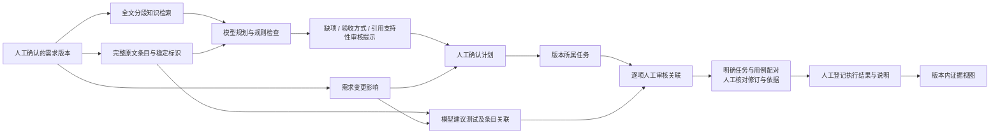

# 需求追踪、边界与迁移恢复

本轮为“传智杯 AI WEB 网页开发挑战赛”准备的可复核工程改进。沿用 React/TypeScript/Vite、Fastify、PostgreSQL/pgvector 与可替换服务端模型接口；没有另起框架、自动执行外部代码或把装饰动效当作算法创新。

任务状态更新与确认需求使用相同的项目优先锁顺序。服务端取得锁后读取当前确认需求，任务来源不再当前时返回409 `task_requirement_outdated`，不修改历史状态、不新增状态事件。新需求已提交后，旧页面的排队写入也须重新核对；合法写入先完成、随后确认新需求属于明确的事务先后顺序，不把它改称违规。界面暂停旧看板编辑，并通过统一编辑保护重新读取项目；取消刷新会保留原审核草稿。此改动不需要新增数据库迁移。

## 追踪数据流

知识库的检索与回答保留实际提交的问题。等待期间可以编辑下一次输入，但已显示结果不会被改称属于新问题；再次提交前有明确提示。知识增强回答可取消本地等待，服务端在检索及模型阶段均监听断开、传入取消信号并忽略迟到回复；已发出的请求仍可能计费，不能承诺撤销费用。向量任务中的“回答前检索已完成”只指检索阶段，回答只有真正返回并通过来源ID检查才显示。整次回答有240秒上限，单次模型仍遵循服务配置的更短超时；不自动重试聊天。

需求版本和生成产物保持不可混用的来源ID。条目按非空原文行提取，最多200组，超出时合并连续行、保留完整文本与UTF-16偏移，不是LLM语义分解；标题、说明也可能被列为条目，用户须审核其用途。稳定key由项目、标准化文字和重复序号确定；相同文字在新版本保持逻辑key，但版本内item UUID不同。文字改写产生新key，用户可登记旧条目到新条目的变更关系。条目调整顺序/重复文本及极长文档分组可能改变匹配，不能把标识一致当语义一致。

任务和测试生成提示包含完整需求及条目原文索引；模型返回的关联为“建议”。计划确认只创建任务，不自动确认关联，更不自动登记通过。缺项规则提示未关联原文、产物描述过短、缺少明显验收词或引用支持尚待审核；单任务或零引用不是一律错误。JSON结构、ID存在及无环校验通过只说明结构有效。

`requirement_items` 保存源位置和人工变更关系；`trace_links` 保存模型/人工来源、建议/确认/排除、审核说明、审核者和用例修订；`trace_link_history`、`requirement_change_history` 保留被替换的审核快照。任务与用例的复合外键限制项目和需求版本。列表展示原文、任务、用例步骤/预期与人工执行说明。

统计分别展示任务/测试关联缺口、待复核关联和“有人工通过记录及说明”的条目数。后者必须同时满足人工确认关联、当前用例修订一致、结果为passed、具有执行时间和非空说明；仍不代表平台证明需求正确或代码可运行。没有上传执行附件、没有自动执行器，没有伪造验证结果。

## 长文本和服务容量

需求仍可保存50000字符。规划、测试和文档生成统一最多20000字符；超限在写入运行/调用模型前返回413，保留完整已存原文并提示拆分可独立验收的范围。尚未实现跨超长需求的多轮生成与自动汇总，不能声称50000字符均可生成。允许范围内规划检索按4000字符无丢失分段，记录每段起止及命中ID，按ID去重；用例与计划均接收尾部条件。

同一向量服务origin共享一个活动请求、最多8个等待位；排队15秒、单次总等待默认45秒、索引/检索活动上限120秒。仅网络失败及429/502/503/504有限重试，最多3次；鉴权、输入和畸形响应不重试。浏览器显示本人实际排队/重试/失败状态，可取消检索或索引等待。取消有提交竞态，已完成的索引不会自动撤销；刷新可核对真实状态。队列与活动记录为单进程，不是分布式调度器。

## 迁移与兼容

迁移010增加用例定义修订与历史快照；实际定义编辑使旧执行结果失效、旧快照保留。当前用例定义编辑和执行登记都必须携带expectedRevision：缺省返回428，迟到旧修订请求返回409；没有实际变更时不重置结果。旧客户端需要更新请求契约，已有数据库记录保持不变。

迁移011仅增加列、表、约束及触发器。既有任务和用例的建议key默认空，不伪造历史关联；首次读取已确认版本追踪视图时建立可重算的原文条目索引。既有Agent计划可继续读取，界面标明历史计划缺少条目审核信息。

| 增量迁移 | 新增内容 | 已有数据与恢复边界 |
| --- | --- | --- |
| 012 | 文档修订与历史 | 旧文档从修订1开始，不补造此前历史；编辑缺修订428、冲突409 |
| 013 | 按确认需求记录任务/用例/关联/文档变更序号，文档生成依据快照 | 旧文档快照未知；人工编辑不伪装为重新生成。应用写入/更新路径覆盖，不承诺检测绕过应用直接删表行 |
| 014—015 | Agent心跳、总截止和请求身份 | 保留旧运行；中断在读取时识别，不自动重放收费调用。迟到结果不可复活已停止运行 |
| 016 | 服务端人工计划审核记录 | 确认需acknowledged=true；保留审核身份/时间/摘要。旧计划审核信息未知，不回填 |
| 017 | 明确任务—用例配对、修订与人工审核历史 | 不从同一需求下的两条关联自动推断配对；用例修改、来源未审核和缺执行说明分别提示 |
| 018 | 项目代码草稿与修订 | 仅显式本地保存，未调用模型或执行代码；不从旧审查自动复制；同修订并发写入只有一方成功 |
| 019 | 审查需求版本与不可变来源快照 | 旧审查保留空来源并显示未知；复合外键阻止跨项目需求；换版后历史审查不冒充当前版本验证 |

应用迁移使用既有 `pnpm --filter @gongxu/api db:migrate`，按事务和迁移锁执行；失败整体回滚并保留旧数据。010—019已在本机真实数据库应用，未清库或重置。若在另一环境部署，操作员应先按原有备份制度保存数据库到源码目录之外、验证可恢复，再应用迁移。备份文件不得加入源码ZIP或Git。

代码草稿保留当前保存版本，不是完整代码版本控制；正式代码历史仍依赖项目Git。代码草稿和用户文档属于业务数据，不进入源码ZIP。相同内容保存不递增修订；其他窗口更新后必须核对新版本，不能强制无条件覆盖。

审查来源在模型调用之前固定：完整确认需求、各检索段起止、实际返回的片段原文及ID。检索使用与知识库/Agent共享的有界向量队列，界面显示实际活动。需求已改变时，带旧版本的提交返回409；调用中换版则保存为原版本历史，不将结果移到新版本。快照仅证明提供了哪些上下文，不证明引用语义或模型建议正确。当前审查总等待上限240秒，检索活动仍受既有120秒限制；取消不能撤销已完成提交或供应商计费。聊天真实效果待授权验证。

追踪读取采用短只读可重复读事务，避免用例修订与配对混读；准备期间确认版本改变会返回409，要求刷新。需求确认、计划采用和人工变更关系登记共享项目锁。同一版本审核刷新保留其他表单草稿；发现换版或读取失败时旧快照只读，不能把历史审核写到新需求。

恢复时先停止新增写入，核对迁移记录和本轮Git提交；保留新增表和列，优先恢复到已知可运行应用提交。旧应用对新增列通常可兼容，但自动检查要求当前提交所需迁移存在，不能直接删迁移记录。**不提供删除历史表的自动降级脚本**；确需恢复数据库，应在隔离实例验证备份，再由用户批准数据切换，不能用清空数据库解决。

## 真实能力与未验证范围

文档生成以同一读取快照取得完整的任务/用例标识、用例修订、步骤、预期及人工执行说明，不再截取执行说明前300字符。任务与测试各超过50条、明细与总数不一致或完整结构化资料超过30000字符时，模型调用前明确返回413；保留现有资料和文档。当前没有超限自动分批合成功能，应人工核对报告，不能删除真实证据绕过边界。这次调整不新增迁移，已有文档仍按生成时来源快照判断，不自动重写历史正文。

本轮测试分为规则/HTTP替身、受控浏览器、真实本地PostgreSQL+向量、浏览器真实本地HTTP+数据库（合成账号、模型替身）。收费模型未获本轮单独授权，故新的条目关联提示词对DeepSeek的真实效果、冲突处理、提示注入抵抗性、费用、多人负载均待验证。引用片段在界面可展开核对，但引用支持性没有自动语义裁判。相关评测入口与人工协议见 `evaluation/README.md`。
