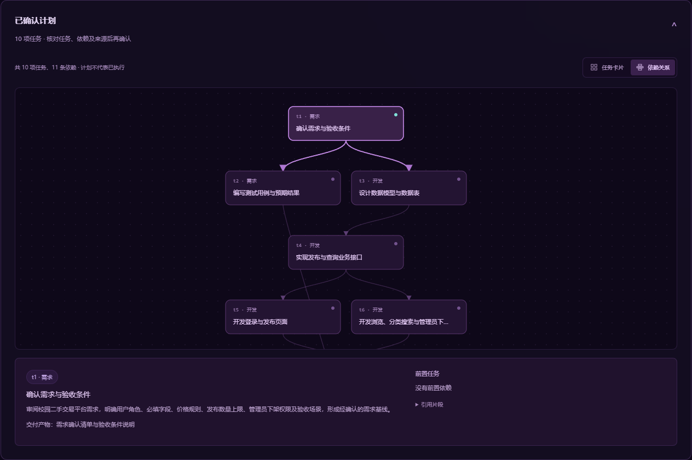

# 工序智伴界面升级与竞赛要求核对

更新日期：2026 年 10 月 31 日。当前范围是前端视觉与交互升级，沿用既有 React、TypeScript、Vite、Fastify、PostgreSQL、pgvector、DeepSeek 与本地 Embedding 架构。本轮没有修改 API、数据库、模型调用、Agent 执行器或原有测试断言。

晚间补充：新增项目推进概览、真实记录快照、需求历史预览与逐行对比。完整操作、版本统计边界、截图和最新验证见 [项目推进与需求版本记录](PROJECT-CONTROLS.md)。下方保留整体皮肤与星环的验收证据。

## 当前可验收内容

- 工作台：统一深空紫黑主题，项目概况来自当前账号实际项目数据；六个实训工具入口可选目标项目后打开既有功能。
- 项目管理：名称与描述搜索、进行中和归档筛选、更新或创建时间排序、名称排序、列表和网格视图。创建表单出现后自动定位，取消后恢复焦点。
- 项目内导航：在需求、Agent、审查、测试和文档间切换，保留原有路由及数据请求。
- 快速导航与显示设置：Ctrl/Cmd + K 搜索页面、项目及当前项目模块，支持键盘选择和焦点恢复；中文输入法确认候选词时不会触发跳转。信息密度、内容字号、侧栏展开状态保存在本地，刷新后恢复。
- 编辑与阅读：需求和文档支持 Markdown 编辑、预览、分栏与复制；AI 回答和审查建议支持标题、表格、代码块与列表。原始 HTML 不执行，模型内容中的外部图片不会自动请求。
- 代码审查：显示行号、可调字号、展开编辑器、复制代码与键盘缩进；保留语法诊断和 AI 建议的明确区分。
- 测试中心：基于真实用例记录汇总数量，按名称、类别、执行结果筛选；过滤不会修改用例或其执行状态。
- Agent 中心：按真实步骤展示检索、规划、校验与审核；任务计划可切换卡片和依赖关系图，已确认任务支持列表、看板、搜索、状态筛选和原有状态保存。不存在的步骤标为“未记录”，计划生成不代表任务已经执行。
- 知识与成长：拖放 PDF/TXT/Markdown 接入既有文件校验与保存流程；实际检索片段可复制、展开和查看来源元数据。任务分布和最近活动来自现有接口，不添加虚构能力分数。
- 长文档：扩大编辑区，提供分栏及文档大纲，按当前实际标题定位；预览内容不执行原始 HTML。网络失败的工作台项目指标显示“—”，重试后恢复真实数量。
- 内容边界：长且无空格的项目名、资料名、任务标题和活动文本在对应区域换行，覆盖 8 个路由、5 种宽度的 40 个组合。该项通过浏览器受控响应测试，没有改写服务器上的项目资料。
- 三维星环：独立预览和工作台均接入 MIT 许可的 SaturnWebGL 粒子轨道代码，使用 Three.js 0.187.0。支持实际正反向旋转、暂停、速度切换、拖动与键盘调整、重置视角、减少动态效果及图形环境恢复。
- 初始渲染：云纹理按约 8 毫秒的短任务生成，给页面输入和绘制留出间隙；与此前同步计算的纹理像素 SHA-256 完全相同。初始化失败会明确提示并提供历史预览入口。

当前预览入口：`http://127.0.0.1:5173/dashboard`。星环独立入口：`http://127.0.0.1:5173/previews/planet-orbit.html`。新版使用本地 JavaScript 模块，需要 HTTP 服务；上一版单文件保留在 `previews/archive/planet-orbit-css-v2.html`。

下图来自隔离演示项目的实际模型计划。选中节点可查看完整说明、交付产物和前置任务；图中的关系不表示任务已经执行：

## 竞赛截图逐项对应

核对依据仍为参赛者上传的七张官方要求截图。截图没有提供评分权重；本表不将设计判断写成官方评分标准。

| 截图可见要求 | 当前对应能力或证据 | 仍需完成的事项 |
| --- | --- | --- |
| C 组适用于高职高专学生；队员 1—3 名且同校，指导教师不超过 2 名 | 产品面向高职软件工程实训，与教育学习及代码开发辅助推荐方向一致 | 团队学籍、人数、学校、报名与缴费须由实际参赛人员核验；不能由应用功能推定参赛资格 |
| 现代前端框架、组件化、状态管理和交互体验 | React 与 TypeScript；深色设计系统、项目工具入口、筛选、结构化阅读、编辑预览、响应式及键盘操作 | 继续进行实际设备体验和可访问性检查 |
| AI 是应用核心，不能只是简单 API 调用 | 确认需求后进行知识检索、模型规划、依赖及引用校验、人工审核，再创建任务；需求、测试和文档与项目关联 | 当前后续审查、测试与文档由用户分别发起，不能宣称已具备全流程自主开发或完整多 Agent 协作 |
| Agent 方向强调规划、工具调用及多轮交互 | 既有执行记录和工具输入输出来自实际运行；前端保留运行中刷新、错误状态与审核入口 | Agent 进程意外中断后的恢复仍属于后续能力 |
| RAG 方向结合向量数据库、检索增强生成 | PDF/文本解析、分块、真实本地 Embedding、pgvector 检索与来源展示已联调；增强回答保留引用核对提示 | 补充有使用权的课程知识资料，建立检索与引用质量评测集；当前示例测试不等于完整课程覆盖 |
| 原创应用，禁止照搬开源项目参赛 | 软件工程业务保持现有自主实现；开源星环仅为明确标注的视觉组件 | 技术文档列出第三方组件及许可，不把粒子渲染或星球视觉当作原创 AI 技术成果 |
| 用户目标：专业知识驱动代码辅助 | 现有知识增强用于问答与 Agent 规划；审查明确区分语法诊断和 AI 建议 | 当前审查只读取提交的代码，尚未自动汇入项目需求或 RAG 来源；这是后续业务增强项，本轮按要求未改后端 |
| 优秀 UI/UX，解决真实问题 | 围绕创建、确认需求、审核任务、审查、测试记录和交付进行界面组织；新增入口均连接实际功能 | 收集真实学生实训反馈及可复核案例，验证学习价值 |
| GitHub/Gitee 仓库可供评委访问，保留真实 Git 历史 | 本地保存真实变更与提交；第三方源码、完整许可和版本均可追溯 | 远程公开仓库或评审访问权限仍需核验；本地 Git 不等于已提交仓库 |
| README、环境变量模板、依赖清单和团队信息 | 已有运行说明及空密钥模板；新增前端依赖写入锁文件，发布资源保留许可 | 补充真实团队信息，发布前从干净环境验证安装和启动 |
| 5—8 分钟 MP4，至少 1080p，普通话讲解 | 界面已具备连续演示需求到文档的入口，真实浏览器联调保留截图 | 正式视频尚未录制；不能用星环片段替代完整功能演示 |
| 技术 PDF 不超过 30 页，说明架构、AI 方案、测试部署和创新 | 当前仓库记录可作为证据材料 | 正式 PDF 尚未交付，需重点说明 AI 选型、集成与优化策略 |
| 在线演示为可选加分项，评审期可用；登录须提供评审账号 | 当前本地版本可运行 | 公网地址、服务保障与专用评审账号尚未交付 |
| 2026 年 11 月 18 日报名及作品提交日期 | 研发以该日期倒排 | 具体截止时刻、指导提交及后续最终提交流程以赛事有效通知和个人中心为准 |

截图中的 MCP、端云协同和多模态包含背景或推荐技术说明，未见每个参赛作品必须全部实现的明确条款。本轮不为堆砌术语更换架构。PPT 与讲稿属于项目自定交付目标，截图中未显示为本阶段必交项。

## 实际验证

| 检查 | 2026 年 10 月 31 日本轮结果 |
| --- | --- |
| 原有自动化测试 | 52/52：API 48、Embedding 4；0 失败、0 跳过 |
| 类型检查与生产构建 | 三个包全部通过 |
| 真实接口联调 | 14/14，实际 DeepSeek、PostgreSQL 与本地向量服务 |
| 原有真实浏览器流程 | 6/6，含 Agent 执行记录与审核、数据持久化和注销 |
| 可重复执行的新界面流程 | `pnpm smoke:ui --with-ai` 11/11；含真实 Agent 依赖图与任务状态、测试生成及人工记录、文档导出；生产构建默认流程 8/8 |
| Windows WebKit 工作台交互 | 5/5，含焦点恢复、显示偏好、文档大纲、Agent 图/看板与各路由响应式 |
| 网络异常及文件拖放 | 5/5；受控断网、未配置状态为测试注入，拖放及校验连接实际前端流程；不称模拟错误为真实模型调用 |
| 核心逻辑保护 | 对比 `096ca68` 的 47 个既有异步处理、数据回调和 effect 均未改变；API、Embedding、数据库、原有联调脚本无变更 |
| 可访问性 | 10 个路由的 axe 自动检查无违规项；8 页基础颜色对比度诊断无违规项，渐变/毛玻璃仍需人工检查，不能据此宣布完整 WCAG 合规 |
| 持续运行 | 正式构建连续 45.02 分钟、90 轮切换通过；异步纹理版另完成 30.02 分钟、60 轮。每轮可见时绘制，离开视口时停止，无脚本错误或图形上下文警告 |
| 星环 Edge 检查 | 9/9 |
| 星环 Windows WebKit 检查 | 9/9；不是 Safari 真机结论 |

星环检查不仅读取 CSS 动画属性，还比较连续画面，并观察实际 GPU 时间参数。三条轨道实测方向分别为正、反、正，2 倍速前后角速度比约为 2；暂停和减少动画期间未持续提交绘制。检查还覆盖 320、390、768、1920 宽度和 WebGL 上下文恢复。有限本机测试不能证明所有硬件恒定 60 FPS。

动效检查已经整理为仓库命令 `pnpm smoke:visual` 和 `pnpm smoke:visual --webkit`。最终异步纹理版本在正式构建上分别通过 9 组检查，无新增依赖。另在 8 倍 CPU 限速下验证纹理尚未完成时仍可操作页面，以及 12 次初始化中途切换页面；三维 iframe 全部释放，没有未捕获脚本错误。WebGL 不可用和受控初始化异常均展示真实降级提示。

一次本机诊断使用冷缓存、4 倍 CPU 限速、150 ms 网络延迟与 1.6 Mbps 下载速率。纹理分段前，桌面/移动场景最大长任务约为 813/795 ms；分段后约为 132/99 ms，三个场景观察到的布局位移均为 0。首屏资料可操作时间仍约 1.9—2.0 秒，说明本次主要改善初始化期间的响应，不宣称全面提速。正式预览服务器未配置压缩；这些为有限本机诊断，不是线上真实用户 Core Web Vitals 或通用性能保证。

持续运行中，垃圾回收后的页面 JS 堆采样约为 3.95–5.06 MB，事件监听器数保持 214；初始加载后抽样的文档数为 2、DOM 节点数为 774。没有出现随 90 次切换持续增长的样态，但这不是 GPU 显存或整个浏览器进程的完整内存测量，也不能替代长期并发压力测试。异步纹理版的独立 60 轮复测也已完成，错误和警告均为 0。

脱敏后的验证摘要见 [本地验证记录](verification/ui-2026-10-31.json)，保留检查名称、状态、来源文件哈希和能力边界，不包含账号、令牌、配置或模型响应正文。该摘要是开发者生成的本地证据，不是独立认证。

新增业务界面检查使用隔离测试账号，项目名称明确含“演示”，未覆盖或删除参赛者原有项目。测试账号内的人工测试结果用于验证操作和持久化，不代表自动运行了代码或证明示例软件正确。

本地证据保存在被 Git 忽略的 `.runtime/`：

- `smoke-ec4ff7e2-04ce-4be4-9029-fab57eb00bbe.json`：最后一轮 14 项真实业务接口。
- `browser-a158fcd1-0912-47ce-ae23-7eed230b1846/report.json`：最后一轮 6 项原有真实浏览器业务。
- `cosmic-ui-review/ui-report.json`：8 组新增交互与响应式验证。
- `saturn-review/edge/report.json`、`saturn-review/webkit/report.json`：三维动效检查。
- `ui-b6576594-a742-45cb-81b7-f51000e0a07b/report.json`：最后一轮正式构建 11 组真实交互，包含新增中文输入法及拖放检查；`ui-8ddd9fbe-05ca-4273-8060-7c5ef00ea44f/report.json`：此前生产构建默认 8 组交互。
- `cosmic-ui-review/webkit-workspace-report.json`、`fault-and-drop-report.json`：WebKit 工作台与受控异常/拖放检查。
- `cosmic-ui-review/soak-report.json`：45 分钟正式构建连续运行；`business-boundary.json`：核心处理函数未变更对照。
- `cosmic-ui-review/accessibility-report.json`、`contrast-base-report.json`：自动可访问性与基础颜色诊断，后者仅在测试标签页移除渐变以便测量。
- `cosmic-ui-review/media/planet-motion-1080p.webm`：本机实际渲染的短动效录像。仅为无旁白的视觉验收片段，不满足正式 5—8 分钟 MP4 交付要求。
- `visual-34bbfce5-06cb-42c3-88a4-86432a59a106/report.json`、`visual-3e128861-1d3d-4400-a2ce-3e321e79f4b6/report.json`：正式构建上可重复运行的 Edge / WebKit 星环测试。
- `cosmic-ui-review/texture-review.json`、`startup-lifecycle-report.json`、`performance-before-slicing.json`、`performance-report.json`：纹理像素一致性、初始化中的交互/释放、降级和前后性能诊断。
- `cosmic-ui-review/long-content-report.json`：40 个长文本组合；`ui-81cac64c-f082-43ef-ade0-7f87ebf0795c/report.json`：加入长文本与菜单减少动画检查后的 8 组默认 UI 回归。
- `ui-be0c6fda-a375-43bb-92e9-27db3bccc3f5/report.json`：最终长文本及菜单动效版本的 11 组完整新 UI 流程；52 项原测试与三包类型检查同轮通过。

## 开源组件边界

星环轨道代码来源为 [Adel Massimo Ramadan 的 SaturnWebGL](https://github.com/adelmassimo/SaturnWebGL)，固定提交 `c960494e221d6a722b8fb5d9973d6d649d806f72`，MIT 许可。保留原始顶点着色器、完整版权声明及修改说明；适配当前 Three.js API，降低粒子数量，加入紫青色材质、明亮粒子簇和按秒计时的旋转控制。没有引入原项目的音乐、外部贴图或旧版 jQuery 界面。

Three.js 版本为 0.187.0，来自官方 npm 包，压缩后本地提供。来源、构建方式和 SHA-256 清单位于 `apps/web/public/previews/vendor/`。Markdown 组件使用 react-markdown 10.1.0 与 remark-gfm 4.0.1；前端依赖的原始许可集合位于 `apps/web/public/THIRD-PARTY-LICENSES.txt`。

## 后续优化顺序

1. 保持已验证的长文档、实际 Agent 阶段、键盘焦点和异常恢复；收集真实学生使用反馈，再针对实际困难调整。
2. 在实际参赛演示电脑与浏览器检查字体、图形效果、投影可读性及网络条件，保留减少动效选项。
3. 以真实检索、工具记录、人工审核、用例状态与文档导出组成连续竞赛演示；视觉动画仅作界面辅助。已整理 [6 分 40 秒演示路线与讲解提纲](DEMO-WALKTHROUGH.md)，仍需实际录制成片。
4. 发布部署、正式视频、技术 PDF、答辩材料和团队资格信息仍作为独立交付项推进，不以本轮 UI 验收代替。
