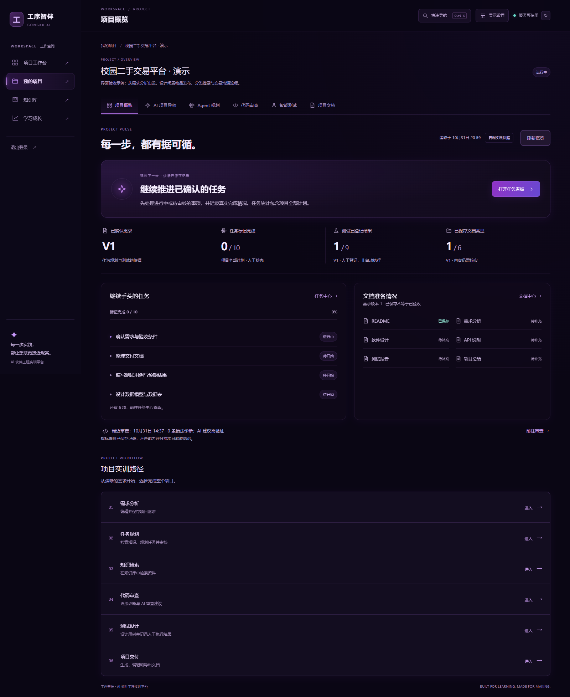
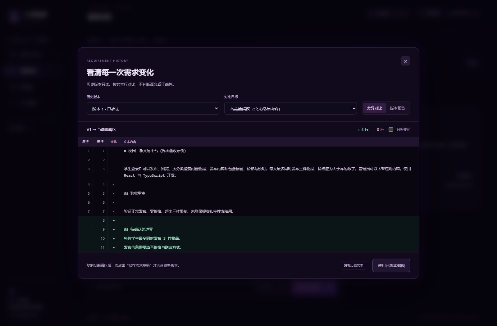

# 项目推进概览与需求版本交互

日期：2026 年 10 月 31 日晚。用户授权继续补充实用交互。本轮以 `123d046` 为增量基线，保留既有业务、接口、模型调用及原有 52 项自动化测试。

## 已完成的操作

### 项目推进概览

在“我的项目”打开任意项目即可看到。使用现有的五个只读接口读取规划、任务、用例、文档和审查记录；没有新增后端路由或自动模型调用。

- 显示最近已确认需求版本；有更新草稿时提示先检查并确认。
- 按项目全部计划的实际任务状态统计已完成、阻塞及待处理事项，并说明状态由用户维护。
- 只统计最近已确认需求下的测试与文档。旧版本通过记录和重复文档类型不会重复计数。
- “下一步”由当前保存状态给出确定性提示，明确标注依据，不宣称这是 AI 生成建议。
- 文档按六类呈现“已保存 / 待补充”；已经保存不等于内容准确或正式验收通过。
- 可刷新概览，复制带时间、需求版本与统计范围的实践快照。
- 独立处理部分请求失败；缺失数据显示“— / 暂不可用”。离开页面会取消读取，避免旧项目响应进入新视图。
- 规划、审查、文档接口最多返回 100 条，用例最多返回 200 条；达到上限时明确提示可能遗漏历史记录。任务接口没有需求版本字段，因此任务指标明确是项目所有计划，未伪装成单版本任务统计。

下图来自已有的隔离演示项目，数据由真实操作产生，不是学生能力得分：



### 需求版本查看与对比

需求页右侧每个历史版本均可打开；“比较版本”默认对照较早版本与当前编辑区。

- 选择任意历史版本，查看安全渲染后的 Markdown 正文或复制原文。
- 与另一个已保存版本或当前编辑区比较。增删行以颜色、符号和原始行号共同表达，支持只看变化。
- 比较按文本行进行，不声称判断需求语义或质量。换行符先统一处理。
- 大段变化的比较表限制为 250000 个单元，超出时以整段替换展示并告知含义；初始仅渲染 400 行，可继续展开。
- “使用此版本编辑”先确认是否替换未保存内容。取消时保留草稿；确认后只改当前编辑区。用户点击原来的保存按钮后才新增版本，已保存历史不修改。
- 弹窗支持 Esc，关闭后恢复触发按钮焦点；专门修复了 Windows WebKit 点击按钮不自动聚焦导致的焦点丢失。
- 历史正文沿用安全 Markdown 组件，不执行原始 HTML，也不会自动加载正文中的外部图片。

下图中的新增边界为截图时在本地编辑区输入、尚未保存的说明，背景版本为演示项目中的真实需求记录：



## 视觉与加载

沿用深空紫黑底色、细紫边框、半透明面板和现有按钮系统。概览用一组指标、一个优先操作区和任务/文档双栏组织信息，避免把每个数字拆成独立大卡片。移动宽度将指标改为双列、内容改为单列；长文本在对比区内换行。

新增两个视图按需加载。正式构建主包为 488.03 kB（gzip 149.52 kB）；项目概览约 13.61 kB、版本对比约 8.01 kB，分别进入对应页面后加载。没有提高构建警告阈值，也没有引入新依赖。

## 实际验证

| 检查 | 结果 | 范围 |
| --- | --- | --- |
| 原有自动化测试 | 52/52 通过 | API 48、Embedding 4；0 失败、0 跳过，部分使用替身 |
| 新增前端规则测试 | 15/15 通过 | 版本隔离、重复文档、读取失败、有限历史、人工状态、逐行比较与大段文本 |
| 原有真实接口联调 | 14/14 通过 | 实际 DeepSeek、PostgreSQL、pgvector 和本地 Embedding |
| 原有真实浏览器流程 | 6/6 通过 | 注册、需求、知识索引、Agent 过程、审核、路由及注销 |
| 全站新 UI 回归 | 11/11 通过 | 正式构建，包含实际模型交互、任务状态、测试记录与文档导出 |
| 本轮新增浏览器流程 | Edge 8/8，Windows WebKit 8/8 | 正式构建，保存/对比/恢复/另存、焦点、刷新、快照与长文本 |
| 自动可访问性诊断 | 4 个界面状态无违规项 | 概览、需求历史、对比弹窗、替换确认；仍有工具无法判断的颜色等项，不代表完整 WCAG 合规 |
| 响应式 | 320 / 390 / 768 / 1440 / 1920 | 概览与长文本弹窗没有页面横向溢出 |
| 原逻辑边界检查 | 47 处保持一致 | 对比 `096ca68` 的原异步处理、数据回调与 effect；API/Embedding/原联调脚本未改动 |

各套检查相互有重叠，不相加为独立测试总数。受控接口失败及跨版本数据只存在于专项浏览器测试，报告中标明；实际应用没有模拟数据分支。

复现命令：

```sh
pnpm test
pnpm typecheck
pnpm build
pnpm test:ui-models
pnpm smoke:project-controls
pnpm smoke:project-controls --webkit
pnpm smoke --with-ai
pnpm smoke:browser --with-ai
pnpm smoke:ui --with-ai
```

后三项包含真实云模型调用。WebKit 缓存位置、运行前提与回环地址限制见 README。

脱敏摘要见 [本轮验证摘要](../verification/project-controls-2026-10-31.json)。本地原始证据：

- `.runtime/project-controls-b12f308d-d205-428b-8fae-cd83e6f40b13/report.json`：正式构建 Edge。
- `.runtime/project-controls-651bc45b-f4d0-44d1-bb76-4aef3951bb15/report.json`：正式构建 Windows WebKit。
- `.runtime/smoke-337055a6-c3c4-4238-ab97-fc4ff50997d2.json`：14 项真实接口。
- `.runtime/browser-1b9880c4-1bd3-4953-a9cf-3d97d158ed14/report.json`：6 项原浏览器流程。
- `.runtime/ui-4c638855-678c-44c2-a43e-62b45507668e/report.json`：11 组全站 UI。
- `.runtime/project-controls/accessibility.json`：4 个状态的自动诊断。

## 对竞赛目标的作用与边界

这轮增强了需求变更可追溯、人机审核和跨阶段记录的一致呈现，有助于演示 AI Native 工程实践。它没有把统计面板包装成自主 Agent，也没有把人工测试记录说成平台执行结果。

仍需推进真实课程资料的检索评测、跨阶段 Agent 工具调度、学生试用反馈以及正式竞赛材料。公网部署、远程评审权限、团队资格、正式 5—8 分钟 MP4 和不超过 30 页的技术 PDF 未由这轮 UI 开发完成。
