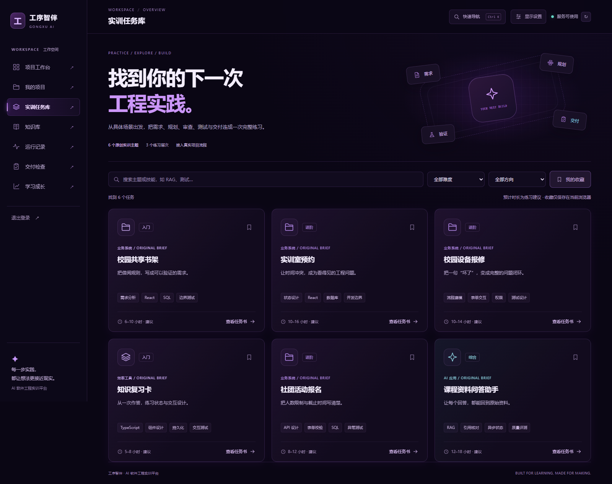
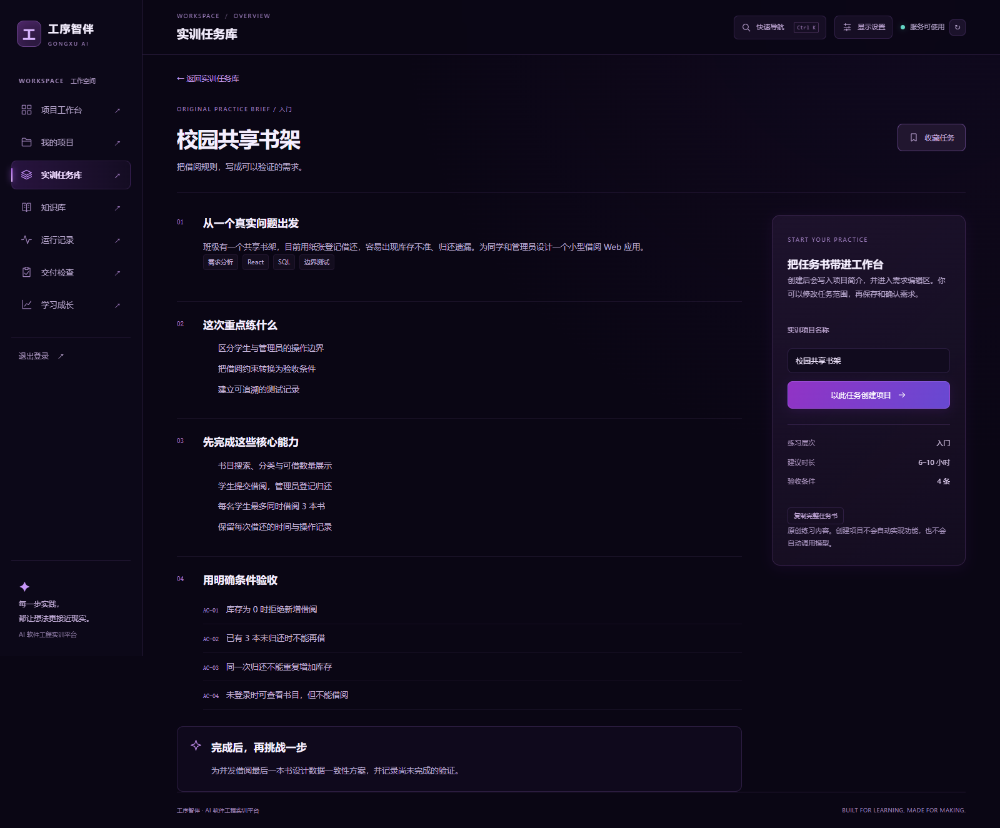
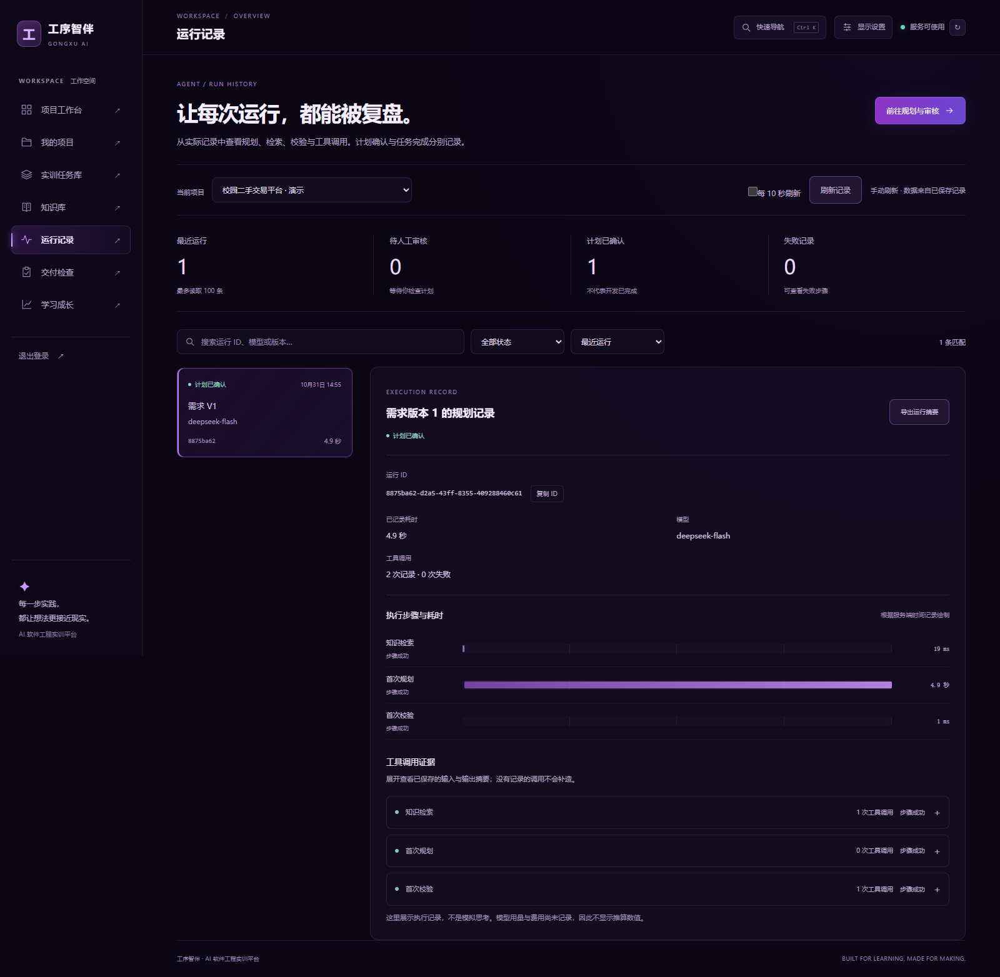
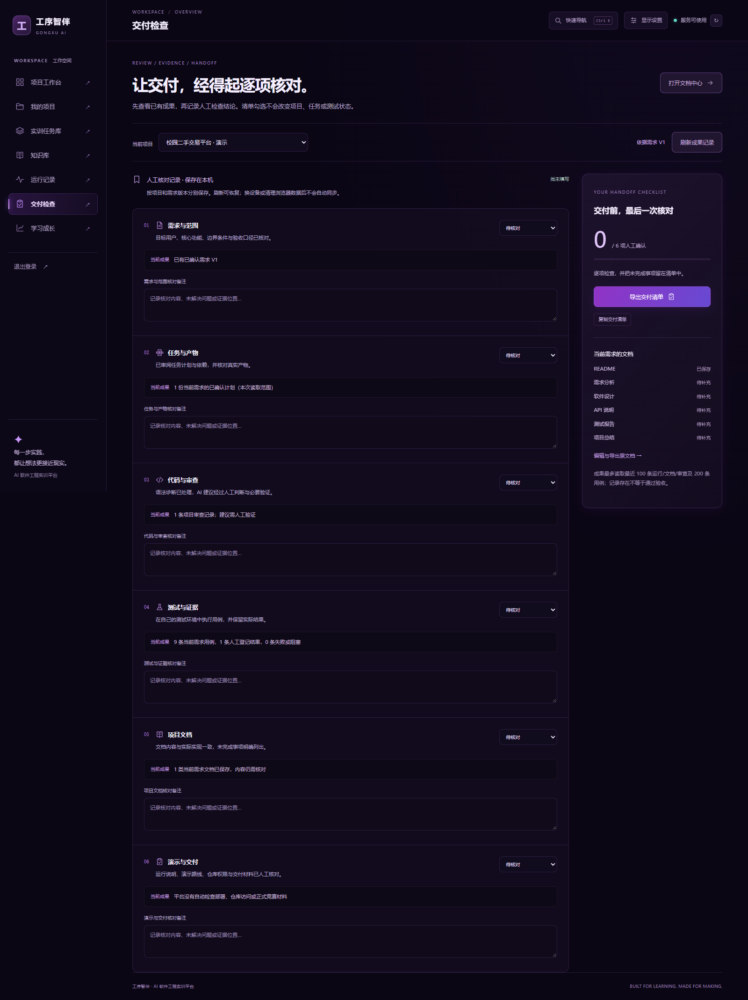

# 工序智伴：任务库、运行记录与交付检查

更新日期：2026-10-31。本轮根据用户“查找网上其他案例，再增加页面和功能”的要求，增加三个工作台入口及六份原创实训任务详情，沿用原有后端、数据库、模型与业务接口。

## 公开案例与采用方式

| 查阅的公开案例 | 值得采用的交互 | 在工序智伴中的具体实现 |
| --- | --- | --- |
| [roadmap.sh Projects](https://roadmap.sh/projects) | 按方向、技能和难度寻找项目，再阅读具体任务 | 实训任务库：关键词、难度、方向、收藏筛选；任务详情包含目标、范围与验收条件 |
| [Dify Logs](https://docs.dify.ai/en/use-dify/monitor/logs) | 从运行历史下钻到步骤和输入输出，定位失败 | Agent 运行记录：按项目和状态筛选，查看时间线、工具输入输出摘要，导出实际保存的记录 |
| [Langfuse Observability](https://langfuse.com/docs/observability/overview) | 以结构化轨迹解释模型与工具执行，保留可核查信息 | 运行详情逐项展示已有阶段、耗时、状态与工具证据；不推算未记录的 Token、费用或内部推理 |

同时通过 GitHub 插件阅读了 [Dify README](https://github.com/langgenius/dify/blob/main/README.md) 与 [Langfuse README](https://github.com/langfuse/langfuse/blob/main/README.md)。本轮仅借鉴公开产品的信息组织方式，没有复制它们的代码、图像、任务正文或商标，也没有引入相关服务或依赖。roadmap 仓库文件未成功读取，任务库参考依据为其公开项目网页。

三份材料解释的是参考来源，不构成主办方评分标准。竞赛约束仍依据用户提供的七张官方要求截图及仓库的 [竞赛核对清单](competition-checklist.md)。

## 新增页面与实际功能

| 路由 | 能够实际完成的操作 | 数据来源与保存位置 |
| --- | --- | --- |
| `/missions` | 搜索、按难度与方向筛选、收藏、只看收藏、清除筛选 | 六份原创任务书随前端提供；收藏保存于当前浏览器 |
| `/missions/:id` | 阅读完整任务书、复制、修改项目名称、创建真实项目 | 调用既有项目创建接口，把任务书写入项目简介并进入需求编辑页；需求仍需手动保存和确认 |
| `/runs` | 切换项目，搜索 ID/模型/需求版本，按状态和耗时筛选排序，查看步骤与工具摘要，复制、JSON 导出，手动或每十秒刷新 | 从已有运行、需求和工具记录接口读取；离开页面后停止刷新，后台标签页跳过刷新 |
| `/delivery` | 查看当前已确认需求的成果，逐项登记待核对/已人工核对/待处理、保存备注、查看六类文档状态、复制或导出 Markdown 清单 | 成果读取真实接口；人工记录仅在本机按项目及需求版本隔离保存，不改变服务器任务或测试状态 |

左侧导航与 `Ctrl/Cmd + K` 快速导航同步增加入口。新增视图按路由加载，保留既有深空紫黑主题、星球、项目概览、需求版本、知识库、代码审查、测试与文档流程。

六份任务书分别是：校园共享书架、实训室预约、校园设备报修、知识复习卡、社团活动报名、课程资料问答助手。每份包含场景问题、学习目标、核心范围、四条可核验条件和一项选做挑战。预计时长是练习建议；任务书不是已经完成的应用，也不代表用户已有能力或成绩。

## 真实数据边界

- 运行记录最多读取最近 100 条；筛选与统计只涵盖本次读取范围。
- 实际耗时根据服务端开始与结束时间计算。缺失、非法或倒序时间显示“未记录”，不填入模拟时长。
- 记录中的计划确认与开发任务完成是不同状态。只查看记录或导出文件不会确认计划，也不会启动模型。
- 交付成果中的计划、测试和文档按当前已确认需求过滤；代码审查是项目级历史记录。接口读取失败显示“暂不可用”，不把失败当成零条成果。
- 交付清单的人工选择与备注保存在当前浏览器，按项目及需求版本分别保存。换设备或清理浏览器数据不会同步；可以导出清单保留。存储被禁用或空间不足时明确提示未保存。
- 用例结果仍是人工登记。平台不会因勾选交付清单而执行代码、把测试标为通过，或自动宣布项目交付完成。
- 工具摘要按纯文本展示；页面不执行摘要中的 HTML、脚本或代码。接口、身份校验、模型调用、数据库事务均继续使用既有实现。

## 验证结果

| 验证 | 本轮结果 |
| --- | --- |
| 原有自动化测试 | 52/52，通过；API 48、Embedding 4，零跳过 |
| 既有前端规则测试 | 15/15，通过 |
| 新增前端规则测试 | 10/10，通过：任务书接口边界、时间缺失/倒序/进位、存储格式、状态与版本隔离 |
| 真实接口联调 | 14/14，通过；真实 PostgreSQL、pgvector、本地向量服务与 DeepSeek |
| 原浏览器流程 | 6/6，通过；正式构建 |
| 既有全站 UI 回归 | 11/11，通过；正式构建，包含真实 AI 交互 |
| 新页面 Edge 检查 | 12/12，通过；正式构建，包含一次真实 DeepSeek 规划与保存记录的逐项比对 |
| 新页面 Windows WebKit 检查 | 12/12，通过；相同流程，不等同于 Safari 真机验收 |
| 响应式检查 | 四类页面在 320、390、768、1440、1920 像素宽度无横向溢出；另检查长工具摘要 |
| 自动可访问性检查 | 六个页面/展开/空状态视图没有自动报告的违规项；渐变与毛玻璃的完整对比度仍有待人工核查项，不宣称完整 WCAG 合规 |
| 类型与构建 | 三个包全部通过；主包约 489.18 kB，gzip 149.97 kB；新增视图单独加载 |
| 原业务保护检查 | 对比 `096ca68`，47 处原异步处理、数据回调与 effect 未变；API、Embedding、数据库与原联调脚本无改动 |

新增浏览器测试使用隔离的演示账号，真实创建项目、保存需求与调用模型；错误响应、存储失败、恶意工具文本等边界使用明确标识的受控测试响应。受控响应不会写入业务数据库，也不作为真实模型效果证据。测试不读取本地密钥配置，不在报告中输出凭证。

可重复运行：

```sh
pnpm test:workbench
pnpm smoke:workbench                 # 11 组；真实本地数据库，不调用云模型
pnpm smoke:workbench --with-ai       # 12 组；额外调用一次真实模型，会产生 API 用量
pnpm smoke:workbench --with-ai --webkit
```

地址与浏览器配置沿用 README 的 `SMOKE_WEB_URL`、`SMOKE_BROWSER_CHANNEL` 和 `PLAYWRIGHT_BROWSERS_PATH` 说明。脱敏的本轮报告索引保存在 [验证摘要](../verification/workbench-2026-10-31.json)，原始报告与诊断截图保留在被 Git 忽略的 `.runtime/` 中。

调试中修复了筛选控件继承全宽样式导致的挤压、768 像素侧栏布局下的筛选溢出和时间显示在秒数进位时出现 60 秒的问题。正式构建验收在停止修改源文件后执行，避免开发热更新干扰长流程中的页面选择状态。

## 与参赛要求的关系

这些页面使学生能从真实场景进入原有 AI 实训流程，并能检查 Agent 证据、人工复核成果，增强教育应用价值和前端交互质量。原创任务书、需求版本与执行证据贯穿同一个项目；没有引入与主题无关的商城、社交或管理模块。

此次扩展不等于新增跨阶段自主执行能力，也不是正式竞赛提交材料。公网部署、评审访问、团队信息、5–8 分钟且不低于 1080p 的普通话 MP4、最多 30 页的技术 PDF、PPT 与讲稿仍需按实际进展独立完成。在线演示在截图中是可选加分项，项目仍按既定目标准备。

## 实际界面

以下截图来自本机真实运行页面。运行及交付页面使用已明确标记的演示项目，其记录由之前的真实服务操作产生，不代表真实学生成果。








